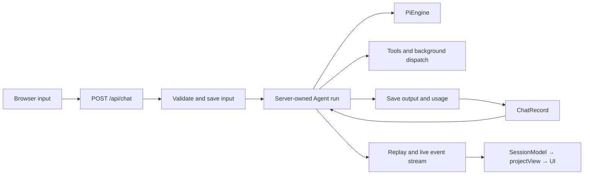
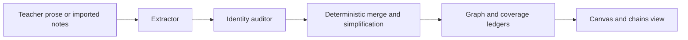

# Architecture

LearnHarness is a Next.js application with an Electron desktop host. The server owns agent runs, conversation records, background work, and filesystem persistence; the browser projects those records into a lesson/practice UI and knowledge graph.

This reference describes the [repository source](README.md#about-these-docs). See [Development](development.md) for commands and [the teaching theory](teaching-methodology.md) for pedagogical intent.

## Code boundaries

| Area | Responsibility / starting points |
| --- | --- |
| `app/` | Pages and HTTP transport; `api/chat/route.ts`, `api/chats/` |
| `components/` | Browser state and presentation; `session-core.ts`, `chat.tsx`, `graph-view.tsx` |
| `src/server/` | Composition, admission, liveness, HTTP-facing services; `chat-handler.ts`, `jobs.ts`, `stores.ts` |
| `src/agent/` | Agent construction, tools, provider streams, workers; `teacher-agent.ts`, `models.ts`, `tools.ts`, `subagents/` |
| `src/core/` | Contracts, record/view projections, domain algorithms; `input-events.ts`, `native-messages.ts`, `view.ts`, `graph.ts` |
| `src/store/` | Filesystem adapters for chats, jobs, graph, settings, and credentials |
| `electron/` | Desktop launch, navigation/permission guards, credential transport, browser helper, updater |

[`eslint.config.mjs`](../eslint.config.mjs) restricts shell imports into `src/` to the core/server barrels, prevents core imports from IO layers, and prevents agents importing server/store adapters.
Dependencies arrive through injected contexts/ports.
These rules are not a proof of pure core, one composition root, or one writer per store: some core modules are Node-bound and excluded from the browser barrel; server modules can import adapters.
Scripts, Electron, and tests are outside these zones.

## Conversations and turns

A **conversation** is a durable `ChatRecord` with native `LhMessage[]`, settings, optional plan, and usage logs.
Missing `kind` means teaching; `practice` selects the practitioner.
An **engine** is the resolved Pi model, stream function, and thinking level.
An application **turn** constructs a fresh native Pi `Agent` from saved history; it can make several model calls and execute tools.
It is not an HTTP connection or a single generation.

[`chat-handler.ts`](../src/server/chat-handler.ts) resolves readiness, waits for compaction, re-reads durable truth, and claims per-chat liveness.
A competing turn gets **409**.
Accepted input is saved before inference; subscription automatic inputs can instead remain staged until dispatch admission.
The HTTP response acknowledges admission, while `GET /api/chats/:id/stream` carries replay/live events and a terminal state.

The stored record has two projections:

- [`toLlmMessages`](../src/core/native-messages.ts) strips app metadata, flattens model-facing markers, applies the active compaction cut, and repairs eligible interrupted tool pairs at the provider boundary.
- [`projectView`](../src/core/view.ts) derives UI messages, question/problem docks, and artifacts. It is not the stored format or provider wire.

Pi seeds the system prompt/tools at construction; that synthetic system message is not persisted. New turns therefore get current instructions. The app does not use the AI SDK's client-transcript replacement or `addToolOutput` loop.

Settlement persists new native messages, plan snapshots, and usage, including partial output on abort. Failed input writes refuse inference; failed reply writes are surfaced before the terminal and do not masquerade as successful empty turns. Cleanup releases liveness. A memory-only failure notice can inform reattaching views without fabricating saved transcript content.

### Streaming and recovery

[`pi/ui-stream.ts`](../src/server/pi/ui-stream.ts) emits native agent events. Partial-message updates replace a slot; they are not accumulated text deltas. Replay retains settled events and the latest in-flight updates, with coalesced live fan-out. Tool IDs are uniquified against history so persistence, answer routing, and provider context agree.

Disconnecting a browser detaches a view, not the agent. Explicit abort is separate. [`session-core.ts`](../components/session-core.ts) owns reattachment, bounded 409 recovery, and adoption of canonical state. One recovery attachment is allowed after premature EOF/read failure; repeated transport failure shows an error.

Question drafts survive optimistic unmount in memory. Uncertain submissions reconcile the saved record and running state before resending, scoped to the same question occurrence. Provider-response retry is explicit: it preserves failed attempts on disk while omitting the eligible failed tail from temporary model context. It is not mount-time replay or automatic retry of arbitrary failures.

## Teaching and practice

[`teacher-agent.ts`](../src/agent/teacher-agent.ts) and the [tool registry](../src/agent/tools.ts) compose different agents over the same teaching history:

| Agent | Interaction | Other tools |
| --- | --- | --- |
| Prober | `probe` or `recall`, `ask_user_question`, `probe_done` | Read-only files, research/PDF dispatch; gated graph readers; document viewer tools |
| Teacher | `quiz` or `explain`, `ask_user_question`, `plan_init` | Read-only files, research/PDF/demo/visual dispatch; `show_image`; document viewer tools |
| Practitioner | `problem`, `conclude` | Read-only files, research/PDF dispatch; gated graph readers; document viewer tools |

The document viewer tools (`read_document`, `read_scanned_section`, `open_document`, `point_to_passage`, `propose_annotation`, `assign_reading`) are always on for every agent; see [Document viewer](#document-viewer).
Mechanic choices, settings toggles, and readiness affect availability.
Practice side tools are composed separately from teaching toggles.
Claude-family agents can receive `send_to_user`.
Argument healing precedes semantic validation; invalid calls return errors the model can correct.

Question tools validate and execute server-side, returning a synthetic terminating placeholder.
It stops a clean question pose, including mixed tool batches, but is not saved.
The actual learner answer becomes the call's result later.
The browser shuffles options and grades select questions; free recall exposes the committed answer for model judgment.
Sibling pending questions are answered without inference until the last is resolved.

A matching successful `probe_done` result selects the teacher and queues a fresh-agent handoff.
A bare/refused call does not.
Planning begins at that seam; displayed teaching begins at the first node-tagged `quiz`/`explain`, not `plan_init`.
The plan is a validated Mermaid DAG, replaceable through `plan_init`.
Current/visited positions derive from tagged calls, not grades.
Waiting for the learner's natural reply to the plan is prompt doctrine, not an acceptance transaction.

Practice uses the same turn/persistence/recovery path, not a separate problem-set service.
[`tools/practice.ts`](../src/agent/tools/practice.ts) commits a statement and solution with `problem`; `conclude` records the outcome and reveals that solution.
A turn-scoped gate enforces one active problem.
The post-conclusion pause is doctrine, not a terminating `conclude` result.
Next adds an explicit marker.
Practice outcomes are session evidence, not graph mastery; ordinary practice settlement skips extraction.

[Prompt composition](../src/agent/prompts/README.md) and [tool-content display recovery](tool-content-recovery.md) have separate references.

## Background work

Research, PDF, demo, and visual tools persist jobs, acknowledge dispatch, and start independent workers through [`subagents/runner.ts`](../src/agent/subagents/runner.ts). Demos are checked using the browser helper; visuals use render-and-inspect loops. PDF/SVG rendering is native; demo execution uses Electron's browser service with system Chrome fallback.

Worker completion and session delivery are separate. The worker saves its outcome and pending-delivery metadata before queueing a marker. [`server/jobs.ts`](../src/server/jobs.ts) delivers by steering a live agent at a native boundary or waking an idle, eligible session. Pending questions, pause, consent, or admission races can hold delivery. Only computing workers are abortable.

A marker in the **saved conversation** acknowledges delivery—not HTTP acceptance or visibility in a stream. Reconciliation avoids replaying saved results; restart recovery restores known pending obligations and can respawn unfinished workers. Legacy terminal jobs without delivery metadata are not guessed into replay. Deleting a session discards its obligations.

This is single-process coordination over JSON files, not a transactional queue or exactly-once provider execution. In-memory composer steers do not have the same durability as job delivery.

### Learner-image snapshots

`show_image` displays a local raster picture; `visual` with an image path annotates it. Both use the file-access policy and shared processing: input bounds of 25 MiB, 16 megapixels, and 8192px per side; off-thread orientation/metadata cleanup; stored PNG/JPEG bounded to 1600px per side and below 1 MiB of base64.

[`learner-image.ts`](../src/agent/tools/learner-image.ts) stores processed bytes under SHA-256 identities in `ChatRecord.imageSnapshots`, deduplicated per session.
Cards and annotation SVGs reference snapshots, so moving the original does not break saved results.
Session-scoped image reads resolve references; SVG downloads embed their image.
The annotator edits a placeholder href, not base64, and uses static native rendering.
Ordinary visual SVGs retain their existing behavior.
Offline regression tests exercise snapshot storage, display, and payload delivery, not model-driven annotation quality.

### Document viewer

A resizable panel beside the transcript shows PDF, Word (`.docx`) and Markdown files, several per session as tabs.
Its state — registered documents, open tabs, the learner's position per document, and annotation proposals — is `ChatRecord.viewer` ([`core/documents.ts`](../src/core/documents.ts)), written only through the synchronous `ChatStore.updateViewer` and never counted as conversation activity.
Layout (tabs, active tab, panel visibility, positions) is replaced by `PUT /api/chats/[id]/viewer`; the panel width and open state are per-device (`lh:document-viewer` in localStorage).

Documents are referenced by path on the desktop (the file stays where it is and is re-checked against the file-access guard on every read) and uploaded in a plain browser (`data/documents/<sha256><ext>`, stored once per content hash and kept when sessions are deleted).
Limit: 100 MB each.
PDFs render in the browser with pdf.js (worker and assets served from `/pdfjs`, outside `/api`); Word is converted to sanitized HTML by mammoth on the server; Markdown renders through the transcript renderer.
A written highlight's note card is pdf.js's own popup; pdf.js places it right of the highlight without checking that it fits, so `pdf-view.tsx` shifts it left once it is shown until it sits inside the page (right-to-left lines end at the right margin, which would otherwise push the card off the viewer and make it scroll sideways).
Scanned PDF pages have no text layer, so text selection, `read_document` and `point_to_passage` cannot reach them; screenshot regions (below) are the way in for the learner, `read_scanned_section` for the agent, and `propose_annotation` can annotate them through a vision-placed box.

Screenshot regions (PDF only): the header toggle or Alt+drag draws a rectangle on one page; Explain this section, Quiz me and Quote then read it.
`POST /api/chats/[id]/documents/[docId]/region` takes `{page, region:{x,y,w,h}}` (fractions of the displayed page), paints only that crop natively (`renderPdfRegion`: pdf.js + Skia, long side capped at 2400 px), and sends it as one image to the `scanReader` role ([`agent/subagents/scan-reader.ts`](../src/agent/subagents/scan-reader.ts); no tools, Markdown out with LaTeX math).
`scanReader` resolves like the other vision roles — its own override in Settings → Agent (per-role overrides under the vision tier), else the `vision` slot — and the model must accept images (a connected Google Antigravity login with a Gemini 3 model works).
The route answers with the transcript and the crop's chat image snapshot; the learner checks and may edit the text (a per-device preference, `lh:region-review`, can skip the check) before it goes to the agent as an ordinary `document-excerpt` whose excerpt carries `region`, `snapshotId` and the transcript as its quote.
The agent sees it flagged as a screenshot region read by a vision model; **Edit and resend** on the card sends a corrected copy flagged as replacing the earlier transcript.
Every read, usable or not, is billed work and is logged on `ChatRecord.scans`, which `sessionCost` folds into the session totals without a per-turn row.

The agent reads scanned PDFs itself with `read_scanned_section({document, topic, form: "text" | "summary", focus?})` (document tools, every agent; [`tools/documents.ts`](../src/agent/tools/documents.ts)).
It names a topic, not pages: a short locator loop on the `scanReader` model ([`subagents/scan-locator.ts`](../src/agent/subagents/scan-locator.ts)) reads the contents, jumps to the section and delivers either its page range (the tool returns the cached verbatim pages, at most 15 per call, with a note where a longer section continues) or a focused summary with page citations.
Pages come from the text layer when a page has one, else from `data/scan-cache/<id>.json` ([`store/scan-cache.ts`](../src/store/scan-cache.ts); keyed by content hash for uploads, path + size + mtime otherwise; no expiry, each page records its model), else from one fresh vision read, counted against a per-call budget of 30 pages and 12 locator steps — nothing reads the whole file.
`server/scan-section.ts` is injected into the tools from the composition root (the agent layer never imports the server), gates the model like the region route (`server/scan-engine.ts` holds the shared gating and usage conversion), and logs every billed call on `ChatRecord.scans` (one entry per fresh page, one for the locator run).
The tool carries its own 5-minute ceiling instead of the default 30 s tool guard.
`read_document` stays text-layer only and tells the agent how many of the pages it showed are scans.
Scanned pages cannot be highlighted with `point_to_passage`: the agent uses the returned page numbers with `open_document`, `assign_reading` and `propose_annotation`.

Annotating a scanned page: `propose_annotation` on a page with no text layer (the page must be given) asks `ScanPassageLocator` ([`server/scan-boxes.ts`](../src/server/scan-boxes.ts), injected like the section reader) where the quote sits.
It paints the whole page, sends it to the `scanReader` model for one plain call ([`subagents/scan-boxer.ts`](../src/agent/subagents/scan-boxer.ts)) and gets back one box per printed line on a 0–1000 grid; the answer is parsed with a schema and refused when it says not-found, is empty or inverted, has more than 40 lines, or boxes nearly the whole page.
The boxes are stored as `DocumentAnnotation.regions` (fractions of the displayed page, the same `PageRegion` as screenshot regions) and the call is logged in `ChatRecord.scans` against that page.
The viewer draws a pending annotation's regions as a dashed box on the page (`.lh-annotation-box`); accepting writes an ordinary PDF Highlight whose `QuadPoints` come from the rectangles, mapped through the page's crop box and `/Rotate` (`regionQuad` in [`annotate-pdf.ts`](../src/agent/documents/annotate-pdf.ts); a test checks it against pdf.js's own viewport at all four rotations).
Placement accuracy is the vision model's; the learner's accept or reject is the check.

Learner → agent: selecting a passage offers Explain, Quiz me, Quote in message and Add to graph.
The first three become a `document-excerpt` marker (the quote is exactly what he selected); before such a turn the server may prepend a `document-viewer` note with the open documents and the learner's position, and one with his decisions on annotation proposals — each only when it changed.
Agent → learner: `read_document` returns text (PDFs under `--- Page N ---` markers); `point_to_passage` and `open_document` only raise a Go prompt, never moving his view; `assign_reading` is a dock-owned tool like the question tools and ends the turn until he presses Done reading or skips; `propose_annotation` is written into the real file only after he accepts it (PDF Highlight annotation, Word comment plus highlight, Markdown `<mark>` plus footnote, all signed "LearnHarness").
Writing re-saves the file whole: signatures on a PDF are invalidated, encrypted PDFs are refused, and a Word file locked by Word keeps the proposal pending.
Passage matching ignores whitespace, punctuation, case, Arabic/Persian letter variants and diacritics ([`core/document-locate.ts`](../src/core/document-locate.ts)).

## Knowledge graph and imports

The graph records objective propositions and jointly-entailing reasoning chains, not learner understanding levels. Construction is post-hoc and independent of the lesson plan:

[`coverage.ts`](../src/core/coverage.ts) fingerprints teacher prose, including successful `send_to_user` text, by actual message ID.
Learner text, thinking, questions, other tool results, and markers do not count.
Automatic extraction is gated by `graph.enabled` and an uncovered-token threshold (default **4096**, minimum **500**).
Rendering is a separate switch.
Manual extraction/import routes do not themselves check the automatic-extraction switch.

The pipeline batches oldest uncovered messages without splitting one message.
Trigger and batch budgets are distinct: current app wiring does not inject the configurable trigger value as the batch budget.
Each source's batches run serially; cross-source work can overlap under a background-LLM semaphore.
A process-wide FIFO lock serializes audit through merge.
These registries survive module entries through `globalThis`, not separate server processes.

The [extractor](../src/agent/subagents/extraction.ts) reads source text and proposes anchored propositions/chains.
The auditor sees propositions and the current graph, not source passages or chains, and submits identity links.
The deterministic merger resolves identities/endpoints, unions provenance, deduplicates arguments, simplifies redundant chains, and checkpoints coverage after graph writes.
Failed stages leave material uncovered; completed chunks and usage survive later failure/abort.
Ordered ledger operations are not an atomic multi-file transaction.

### Notes and source organization

`POST /api/graph/import` feeds text or locally converted PDF Markdown into the same pipeline, without chat-message anchors.
The [import UI](../components/notes-import.tsx) queues one request per supported file, up to three in flight.
Files are capped at 25 MiB; server aggregate file bytes per request are also capped at 25 MiB, with a 26 MiB multipart/proxy bound.
PDF conversion has no OCR; skipped image-only pages and scanner caveats are reported.

Source identity hashes the original path/name; safe folder-relative paths can be supplied alongside matching filenames.
Renaming or reorganizing a displayed source does not change its identity.
Every explicit import processes the whole file, even unchanged text; retry is not exactly-once processing.
Same-source overlap is refused as busy.
Per-file outcomes distinguish completed, partial, failed, aborted, and busy; zero findings can still be a completed import.

`graph/source-organization.json` holds display overrides and folder placement, not original file contents.
Folder imports reconstruct directories containing supported files.
Organization is separate from session-sidebar placement.
Both the chains browser and practice’s node picker hide practice-session source rows; this is a read projection, not deletion of conversations, graph contributions or placements.
Folder selection excludes those hidden sources.
Empty source names are muted in place, using full contents rather than search-filtered counts.
Ordinary chains-view selection selects sources/folders, including descendants hidden by search; practice can select finer-grained graph material.

Deleting sources removes their graph contributions while preserving knowledge supported elsewhere.
Deleting conversations too is an explicit, unchecked-by-default option.
Extraction/live-work preflights prevent conflicting deletion; filesystem failures can leave reported partial progress.
Source organization uses validated operation-based updates.
These guarantees are not a transaction across all graph/session files.

### Read model and other writers

[`graphSnapshot`](../src/core/graph.ts) derives the presentation without starting extraction. Single-premise arguments draw direct arrows; joint premises produce geometry junctions, not extra stored propositions. Clusters derive from birth-source provenance, not embeddings, Louvain, or LLM naming. Layout/render settings are server-persisted; camera state is device-local.

Prober/practice graph tools require both graph and graph-tool switches; the teacher has no graph-reader registry. Explicit graph selections at session creation are a separate context path, not automatic semantic top-K injection.

Extraction is the construction writer, not the only mutation: source/session/node deletion, simplification, and position commits also write graph files. Deleting a proposition removes chains using it; preserving graph on session deletion retains provenance while removing extraction bookkeeping.

## Storage and notifications

[`config.ts`](../config.ts) anchors immutable prompt assets to the application root and mutable state to `LH_DATA_DIR` (default repo `data/`). Storage ports are semantic interfaces in [`ports.ts`](../src/core/ports.ts).

| Data | Files |
| --- | --- |
| Conversations, plans, usage, image snapshots | `chats/*.json` |
| Worker computation and delivery obligations | `jobs/*.json` |
| Propositions, chains, checkpoints, coverage | `graph/{nodes,chains,sessions,coverage}.jsonl` |
| Sources, organization, positions, render preferences | JSON maps under `graph/` |
| Preferences and prompt overrides | `settings.json`, `prompts/` |
| Keys and custom-endpoint binding | Separate `auth.json`, selected by `LH_AUTH_FILE` |

Adapters use synchronous filesystem operations. JSONL reads skip corrupt/invalid lines; graph derivation merges repeated assertions. Some replacements use temp-file rename, but ordinary whole-file writes are not database transactions. Same-event-loop serialization is not cross-process locking or crash atomicity. Use **one server owner per data/auth profile**.

Chats and graph-family files have separate version guards; absent stamps read as v1, and newer versions are refused.
Positions are rebuildable and unstamped.
Settings have their own version/sanitization policy.
Format counters are not app versions.
Golden fixtures exercise compatibility.
Graph-store initialization removes retired ledgers, so importing stores is not a universally read-only inspection method.

`/api/chats/:id/stream` is a turn/view stream.
`/api/events` is a separate window-level notification stream: an ephemeral, process-local signal to fetch canonical data.
[`SERVER_EVENT_TYPES`](../src/core/events.ts) is the event vocabulary.
Consumers debounce and refetch on reconnect; notifications have no durable replay.
A live turn's terminal controls settlement adoption so a notification fetch does not overwrite partial state.
Settlement signals the end of work, not proof of a successful disk write.

## Host and providers

Packaged Electron launches a private standalone Next child on loopback, sets data/auth paths, and loads a sandboxed renderer. Its navigation/permission and credential transport guards are desktop boundaries, not web multi-user authentication. [Desktop releases](desktop-release.md) covers tracing/packaging checks.

[`models.ts`](../src/agent/models.ts) composes Pi providers and app bridges. Strong/Cheap/Vision slots have no factory model pins. Sessions retain explicit choices; background roles resolve independently. Missing configuration/readiness refuses rather than silently choosing another provider.

API environment values override saved keys.
Packaged subscription refresh credentials stay in Electron main; web/dev uses server-owned connection files.
Subscription routes do not fall back to API billing.
[Claude Code](claude-code.md) retains native CLI authentication/routing but bridges LearnHarness tools; [custom endpoints](custom-providers.md) bind authorization to URL/mode and resolve settings per operation.
Neither route has inferred zero-dollar pricing.
[Accounting](compaction-accounting.md) owns context/cache/cost semantics.

### File access and external services

Read-only file tools default to the server user's home, not a selected project or app data root. Walk exclusions reduce noise; they are not access authority. Session attachments carry local paths rather than uploads.

The **sensitive-path guard** refuses known private home locations, `.env` files, configured auth/subscription files, and recognized credential temporary files.
It checks named/canonical paths and aliases; walks skip protected locations.
It is path-based defense in depth, not a content scanner, sandbox, or allowed-folders setting.
Other sensitive files and learning records can remain readable.
See [`fs-shared.ts`](../src/agent/tools/fs-shared.ts).

File/PDF/visual images share image postprocessing. Search supports Tavily, Brave, Exa, Firecrawl, and hosted Ollama adapters; page fetching is independent and does not need a search key. Dictation mints short-lived tokens server-side and streams audio browser → Deepgram. These external effects are not isolated by a scratch data directory alone.

## Verification starting points

Tests use injected engines/ports, fake transports, and renderer seams.
Start with `chat-flow`, `session-core`, `turn-recovery`, `job-delivery-recovery`, `extraction`, `notes-import-route`, `practice-flow`, `prompt-overrides`, and `golden-fixtures` under `tests/`.
Fixture checks establish their exercised contracts, not live account entitlements, teaching quality, or cross-process durability.
Commands and runtime prerequisites belong in [Development](development.md#checks).
