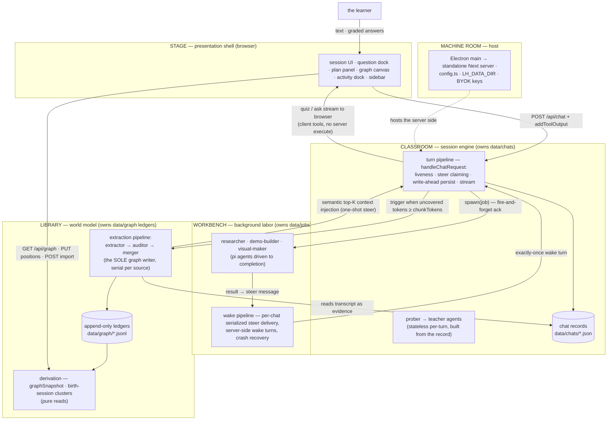

# Development

For product setup, see [Getting started](getting-started.md). For runtime flows, see [Architecture](architecture.md). These guides follow [the repository source](README.md#about-these-docs).

## Setup

CI and release builds use **Node 26**. Use the lockfile and a compatible native build environment:

```sh
npm ci
npm run dev            # normally http://localhost:3000
npm run desktop:dev    # Next dev + Electron on localhost:3000
```

No key is needed to open the UI. Configure connections and the Strong/Cheap/Vision slots before model-driven use; there are no factory model selections. OpenRouter is supported, not mandatory.

```sh
npm run build          # Next production build, including standalone output
npm start              # serve the production build with Next
```

`npm run desktop:dist` is the local **signed macOS** packaging path, not a portable unsigned shortcut. Prerequisites and Windows/Linux instructions are in [Desktop builds and releases](desktop-release.md).

## Configuration

Nonsecret settings are deltas in `<data root>/settings.json`; absent values resolve through `src/core/settings.ts` and `settings-resolution.ts`. Models and role overrides are settings, not environment variables. [Prompt overrides](../src/agent/prompts/README.md) live under `<data root>/prompts/` and require explicit enable switches.

| Variable | Purpose |
| --- | --- |
| `LH_DATA_DIR` | Mutable chats/jobs/graph/settings/prompts; default repo `data/`. |
| `LH_AUTH_FILE` | Keys/custom-endpoint binding; default repo-root `auth.json`, outside `data/`. |
| Provider API-key variables | Optional, selected-provider dependent; UI names are in `src/core/auth-keys.ts`. |
| `TAVILY_API_KEY`, `BRAVE_API_KEY`, `EXA_API_KEY`, `FIRECRAWL_API_KEY`, `OLLAMA_API_KEY` | Optional search adapters. Without a Settings pin, the first keyed engine wins: Tavily → Brave → Exa → Firecrawl → Ollama. A pinned engine requires its own key; no silent fallback. Ollama search is hosted at ollama.com, not a local model server. Page fetching is independent; research can fetch known URLs without a search key. |
| `DEEPGRAM_API_KEY` | Optional dictation token minting. |
| `CHROME_PATH` | Chrome/Chromium executable fallback for demo verification; Electron's browser helper is primary. No extra Chromium is downloaded. |

Ordinary Next development can read `.env.local`. Real environment keys take precedence over saved keys. Saved auth is restrictive-permission plaintext, not an encrypted vault. Packaged Electron sets separate data/auth locations under `userData`; it does not use the repo development profile.

Provider-specific setup and limitations: [Claude Code](claude-code.md), [custom endpoints](custom-providers.md), [context/cost accounting](compaction-accounting.md).

### Subscription connections in web/dev

| Variable | Purpose |
|---|---|
| `OPENROUTER_API_KEY` | required — all LLM calls go through OpenRouter |
| `GOOGLE_SEARCH_API_KEY` + `GOOGLE_CSE_ID` | researcher's `web_search` (Google Custom Search) |
| `DEEPGRAM_API_KEY` | optional — dictation (STT token minting; audio streams browser→Deepgram, never through the server) |
| `CHROME_PATH` | optional system Chrome fallback for demo verification; the app's own browser helper is primary (nothing is downloaded) |

The packaged desktop app takes keys from `userData/auth.json` (BYOK, mode 0600, read/written directly by the server via `LH_AUTH_FILE`). PDFs render natively with pdfjs/Skia; SVGs use resvg.

### Custom APIs and AI subscriptions

**Custom (manual) APIs.** Settings → Providers → *Custom APIs* declares any model endpoint by hand — Ollama, LM Studio, vLLM, LiteLLM, a corporate gateway — as a protocol (`openai-completions`, `openai-responses`, `anthropic-messages`, `google-generative-ai`), a base URL, an optional key/bearer token, and a model list (id, name, context window, max tokens, reasoning, images).
Definitions are one non-secret file, `data/providers.json` (`{"version":1,"providers":[…]}`, schema in `src/core/custom-providers.ts`); it can be hand-edited and is hot-reloaded.
Keys are secrets and live in the credential store, never in `providers.json`.
A custom provider's id cannot shadow a built-in one (model pins are keyed by provider id).
The API is `GET/POST /api/providers`, `PUT/DELETE /api/providers/:id`.

**AI subscriptions.** Settings → Providers → *Subscriptions* signs in with a paid plan instead of an API key: Claude Pro/Max, GitHub Copilot, ChatGPT/Codex (works in plain `npm run dev`; the desktop-only ChatGPT row above is unchanged), Gemini CLI and Antigravity (Google Cloud Code Assist, `src/agent/google-cloudcode/`), plus any other pi-ai provider with an OAuth method.
pi-ai owns each login flow and token refresh; `src/server/subscriptions.ts` lists the providers (`GET /api/subscriptions/providers`) and relays its interaction (sign-in URL, device code, paste-the-redirect prompt) to the UI through a polled login session (`POST /api/subscriptions/:provider/login`, `GET|POST|DELETE /api/subscriptions/sessions/:sid`, `DELETE /api/subscriptions/:provider`).
The login's callback server binds `127.0.0.1` on the machine running the server.
Anthropic and Google may restrict third-party use of these logins — the UI says so before you connect.

Both ride one secrets file, `credentials.json` (mode 0600, next to `auth.json`; `LH_CREDENTIALS_FILE` overrides): pi-ai's `{providerId: api_key | oauth}` credential map behind a serialized-write `CredentialStore` (`src/store/credentials.ts`). The server hands it, plus the custom providers, to the agent layer through `registerProviderSource` (`src/agent/models.ts`).

**Antigravity client identity.** Google's Antigravity endpoint refuses clients it considers stale: it answers HTTP 200 with the notice "This version of Antigravity is no longer supported…" as the model's text and no usage.
The adapter turns that notice into an error that names the fix.
It identifies itself as `antigravity/hub/<version> darwin/arm64`; the default version (`DEFAULT_ANTIGRAVITY_VERSION` in `src/agent/google-cloudcode/stream.ts`, currently the App release from [Google's changelog](https://antigravity.google/docs/changelog)) goes stale when Google raises its minimum.
`PI_AI_ANTIGRAVITY_VERSION` changes only the version and `PI_AI_ANTIGRAVITY_USER_AGENT` replaces the whole string; both are read per request and need the server restarted if set in its environment.
Which identity Google accepts cannot be checked without a live login, so after changing either, send one Antigravity request (for example a region read) and confirm a real answer comes back.

**Antigravity models.** Which Antigravity models exist differs per account and changes over time, so the picker does not trust a fixed list.
Once you are signed in, `GET /api/models` (every picker open) and a successful login ask Google for the account's models (`v1internal:fetchAvailableModels`, same identity and project as chat requests) through `refreshConnectionCatalog` → pi-ai's `Models.refresh`.
The answer replaces the list: the ids in Antigravity's own picker groups that are not disabled, so a model Google retired disappears.
A model the app already knows keeps its price estimate and thinking map; a new one takes Google's name, limits and image support, gets no thinking setting (its tier is in its id) and is priced as free in the estimator.
Every good answer is saved as received to `data/model-listings/google-antigravity.json` (`src/store/model-listings.ts`, handed to the provider through `ProviderSource.listings`), and the provider reads it back whenever the model collection is rebuilt — a server restart or a dev hot reload — so a model pinned from Google's list (a role, a slot, a chat) still resolves before anything is fetched.
A saved list is only a start-up value: the first picker open or login after a rebuild still asks Google, and a model Google retired stays until that fetch succeeds.
The list in `models.ts` is what shows only when nothing has ever been fetched.
A refresh is skipped for 10 minutes after a success and for 1 minute after a failure; failures are logged to the server console and keep the previous list.
A role or chat pinned to a model Google no longer lists fails with "catalog has no model …" until you re-pick it in Settings.

## Architecture

Five layers, dependency arrows pointing inward only, machine-enforced as four ESLint zones (shell → barrels only; core and agent never import below themselves). Two composition roots, one writer per store. The full spec — layers, systems, runtime flows, invariants, seams: [`docs/architecture.md`](docs/architecture.md).



Web/dev writes `chatgpt-credentials.json`, `github-copilot-credentials.json`, and `xai-credentials.json` **beside `LH_AUTH_FILE`**, in the repo by default—not under `data/` or a global Pi profile. Git/build exclusions cover these files and their write temporaries. Refresh serialization is process-local: use one server per credential directory.

ChatGPT's callback listener is `127.0.0.1` on the **server's machine**; complete sign-in in a browser there. Copilot/Grok use device codes. Allow the initiating browser's sign-in tab if blocked; Electron dev opens provider pages in the system browser. Connected browsers share server credentials, background-use consent, keys, and learning data.

This is **trusted local/shared development**, not multi-user hosting.
Same-origin JSON/custom-header checks and short-lived, origin-bound, one-use browser-opening actions are not user authentication or DNS-rebinding protection.
Do not expose the server to untrusted users/public Internet without an independent access/host gate.
Per-user isolation, remote ChatGPT callback routing, and credential import are not implemented.

## Safe local work

Use a disposable data root and a separate empty `{}` auth file:

```sh
LH_DATA_DIR=/absolute/path/to/scratch/data \
LH_AUTH_FILE=/absolute/path/to/scratch/auth.json \
npm run dev -- --port 3001
```

These variables isolate app records/saved keys, **not every external effect**.
Ambient keys still win; subscription files follow the auth directory; Claude Code can use its native profile.
File tools have broad read access under the server's user, subject to the [path guard](architecture.md#file-access-and-external-services).
A scratch data root is not a filesystem or credential sandbox.
Use synthetic fixtures/fake providers for automated reproduction and avoid personal files or ambient credentials.

Do not commit `.env.local`, credentials, or learning records. Do not copy a personal profile into a fixture. Avoid separate writers against live profiles; store initialization and maintenance scripts can mutate data or invoke model stages. Inspect scripts before using them. See [storage and compatibility](architecture.md#storage-and-notifications) before changing formats.

Read the relevant installed Next guide under `node_modules/next/dist/docs/` before framework-facing changes. The import restrictions live in `eslint.config.mjs`; they do not enforce every architectural convention. [Architecture's code map](architecture.md#code-boundaries) and [prompt composition](../src/agent/prompts/README.md) identify the main entry points.

## Debugging

- `LH_PROVIDER_EVENTS=1` saves raw provider events under the selected data root. They may contain private lesson/provider content.
- `LH_BACKGROUND_CAPTURE=auditor` (or comma-separated roles, or `all`) captures background requests/results. Roles are `researcher`, `demoBuilder`, `extractor`, `auditor`, `visualMaker`, `pdfReader`, and `scanReader`; foreground teaching/probing is excluded.
- `next dev` keeps its own log at `.next/dev/logs/next-development.log`: JSON lines (`source` Server or Browser, `level`, `message`) of the running dev server's console and the browser console, including `console.warn` lines such as `[models] …`. Read it first when a bug report comes from a running dev server.

For example:

```sh
LH_BACKGROUND_CAPTURE=auditor npm run desktop:dev
```

The flag must reach the **Next server**; restart an existing server to change it. Captures are off by default and written to `<data root>/debug/background-captures/<role>-<run ID>.json`. Each file retains the last request and response/error/tool results, with prior conversation in that request and compact per-turn timings—not every request body.

`request.format: provider` means adapter-exposed outgoing payload after app transport restrictions; `context` means model-facing conversation, not HTTP wire (for example, CLI).
Captures do not enable thinking or recover reasoning a provider did not return.
Request options/auth headers are not recorded, recognized nested credential/header fields are redacted, and POSIX files are owner-only.
They still contain private source/graph content, have **no automatic expiry**, and require review before sharing and manual deletion when no longer needed.
Capture/serialization errors do not fail workers.

For frontend failures, inspect the actual UI, requests, console, and state. A static render alone does not establish that an interaction works.

## Checks

```sh
npm test               # node:test via tsx; injected engines, fixtures, fake transports
npm run typecheck      # tsc --noEmit
npm run lint           # ESLint, including import restrictions
npm run build          # Next production build
```

`npm run` can fail to start in Git Bash on Windows ("Could not determine Node.js install directory"). Run the same tools directly:

```sh
NODE_ENV=test node node_modules/tsx/dist/cli.mjs --test tests/*.test.ts tests/*.test.tsx   # npm test; one suite: --test tests/<file>
node node_modules/typescript/bin/tsc --noEmit                                             # npm run typecheck
node node_modules/eslint/bin/eslint.js .                                                  # npm run lint (with the next line)
node scripts/check-docs.mjs                                                               # docs prose: one sentence per line, no line over 600 characters
```

Besides the import law, ESLint enforces four mechanical style patterns: `ReturnType<typeof fn>`, an inline `import("…").T` type, a local `isRecord` guard, and member access on an inline cast (`(x as T).member`).
Existing hits are grandfathered per file in `eslint-suppressions.json`, so new code errors while old code passes.
After cleaning old hits up, run `node node_modules/eslint/bin/eslint.js . --prune-suppressions` so the baseline shrinks.

The suite requires no paid models or real sign-in. Some tests use temporary files, native processes, or local fake endpoints: deterministic does not mean every test is pure or cannot bind a loopback port. Inspect focused-suite setup before running beside a live app.

A test that cannot pass on a platform skips there with its reason, so a failing run means a regression.
On Windows that covers POSIX file modes and signals (`process.platform === "win32"` guards), file symlinks (they need Developer Mode or an elevated shell; `tests/helpers/symlink.ts` probes for it, and directory junctions never need it) and the Electron subscription loader (`require.resolve` ignores `module.registerHooks` before Node 26).
Absolute Windows paths given to `--import` or `import()` must be `file://` URLs (`pathToFileURL`).

To drive a real browser against a change without disturbing a running dev server or its data, use the isolated copy, scratch data and fake model in [`scripts/verify-rig/`](../scripts/verify-rig/README.md).

[Golden fixtures](../tests/fixtures/golden-data/README.md) exercise saved records through production paths. Keep compatibility expectations with intentional format changes; do not hand-edit fixture content to make tests pass. [Standalone skill-reader tests](../tests/skills/README.md) run separately with Python and no app runtime.

Additional runtime gates have prerequisites:

| Check | Prerequisite / purpose |
| --- | --- |
| `node scripts/smoke-provider-runtime.mjs` | Fresh build; traced provider payload/runtime paths with fixtures. Also used during packaging. |
| `node scripts/smoke-web-subscriptions.mjs` | Build, no dev server running; isolated synthetic connection checks, external traffic blocked. Briefly changes/restores a source mtime to exercise reload. |
| Other `scripts/smoke-*.mjs` | Standalone/native renderers, image workers, demo helper, compression, file paths, opening. Read each script and the [release guide](desktop-release.md) before running. |

Run checks proportionate to the change. Offline gates prove exercised contracts, not live entitlements or model-authored lesson quality.
